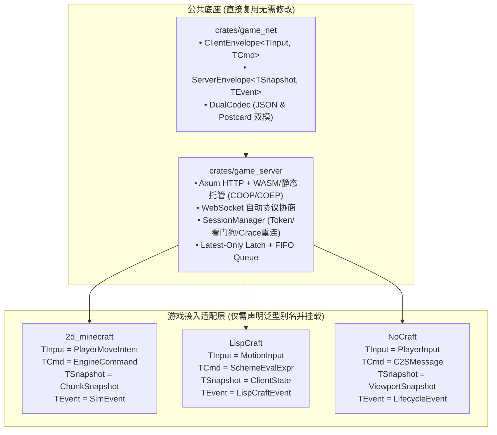

# 跨游戏通用网络底座移植与接入指南 (Cross-Game Networking Porting Guide)

本文档面向 **LispCraft** 与 **NoCraft** 的负责 Agent，详细说明如何将 `crates/game_net` 与 `crates/game_server` 零摩擦平移并接入到各自的游戏引擎中，实现统一的 **WebSocket 全双工通信、Web 浏览器 WASM 客户端直连、双模自适应编解码（调试 JSON / 正式 Postcard 二进制）、Token 鉴权与高频输入锁存流水线**。

---

## 1. 架构总览与零侵入设计理念

`game_net` 与 `game_server` 采用纯泛型抽象设计，不依赖任何特定游戏的方块、地图或渲染类型。



---

## 2. 依赖引入方式

两个 Crate 既可以直接通过本地路径依赖（推荐目前阶段），也可发布到统一库：

在各自项目的 `Cargo.toml` 中添加：

```toml
[dependencies]
# 方式 1: 直接引用 2d_minecraft 的共享实现
game_net = { path = "../2d_minecraft/crates/game_net" }
game_server = { path = "../2d_minecraft/crates/game_server" }

# 或者方式 2: 拷贝至各自项目的 crates/ 目录
# game_net = { path = "crates/game_net" }
# game_server = { path = "crates/game_server" }

serde = { version = "1.0", features = ["derive"] }
tokio = { version = "1.38", features = ["full"] }
```

---

## 3. LispCraft 适配步骤与示例

### 3.1 定义游戏 Payload 绑定
在 `LispCraft` 的网络适配模块中（如 `src/net_adapter.rs`）：

```rust
use serde::{Deserialize, Serialize};
use game_net::{ClientEnvelope, ServerEnvelope};
use game_server::GenericGameServer;

/// 高频输入（移动/鼠标方向，每帧覆盖锁存）
#[derive(Serialize, Deserialize, Clone, Debug, PartialEq)]
pub struct MotionInput {
    pub x: f32,
    pub y: f32,
    pub facing_dir: u8,
}

/// 离散交互指令（Scheme 表达式求值或控制指令，严格保持 FIFO 顺序）
#[derive(Serialize, Deserialize, Clone, Debug, PartialEq)]
pub struct SchemeEvalExpr {
    pub expr: String,
}

/// 视口与实体快照
#[derive(Serialize, Deserialize, Clone, Debug)]
pub struct ClientStateSnapshot {
    pub tick: u64,
    pub entities: Vec<EntityDesc>, // 对应 LispCraft 原有的 EntityDesc
}

/// 离散广播事件（系统通知、音效等）
#[derive(Serialize, Deserialize, Clone, Debug)]
pub struct LispCraftEvent {
    pub message: String,
}

pub type LispCraftServer = GenericGameServer<MotionInput, SchemeEvalExpr, ClientStateSnapshot, LispCraftEvent>;
```

### 3.2 启动网关并对接游戏主循环
```rust
use game_server::{ServerConfig, start_server};
use std::path::PathBuf;

#[tokio::main]
async fn main() -> Result<(), Box<dyn std::error::Error>> {
    let config = ServerConfig {
        bind_addr: "0.0.0.0:8080".parse()?,
        heartbeat_timeout_secs: 10,
        grace_period_secs: 60,
        static_dir: Some(PathBuf::from("assets/web")), // 浏览器访问自动下发 WASM
    };

    let (server, handle) = start_server::<MotionInput, SchemeEvalExpr, ClientStateSnapshot, LispCraftEvent>(config).await?;
    println!("LispCraft Server running on http://0.0.0.0:8080 and ws://0.0.0.0:8080/ws");

    // 游戏主仿真循环
    let mut interval = tokio::time::interval(std::time::Duration::from_millis(50)); // 20 TPS
    loop {
        interval.tick().await;

        // 1. 获取所有玩家的最新高频输入（最新一帧，无堆积延迟）
        let latest_inputs = server.drain_inputs();
        for (player_id, input) in latest_inputs {
            // 更新该玩家在 Scheme/世界中的物理位置
        }

        // 2. 获取所有玩家的有序业务指令（FIFO）
        let pending_cmds = server.drain_commands();
        for (player_id, cmds) in pending_cmds {
            for cmd in cmds {
                // 在 Scheme 虚拟机中求值表达式
                // scheme_vm.eval(&cmd.expr);
            }
        }

        // 3. 广播当前世界状态
        let snapshot = ClientStateSnapshot { tick: 1, entities: vec![] };
        server.broadcast(ServerEnvelope::Snapshot(snapshot));
    }
}
```

---

## 4. NoCraft 适配步骤与示例

### 4.1 定义游戏 Payload 绑定
在 `NoCraft` 中（直接桥接 `engine-protocol`）：

```rust
use serde::{Deserialize, Serialize};
use game_net::{ClientEnvelope, ServerEnvelope};
use game_server::GenericGameServer;

// 复用 NoCraft 已有的协议定义
use engine_protocol::{PlayerInput, C2SMessage, ViewportSnapshot, LifecycleEvent};

pub type NoCraftServer = GenericGameServer<PlayerInput, C2SMessage, ViewportSnapshot, LifecycleEvent>;
```

### 4.2 接入与会话生命周期
`game_server` 自带的 `SessionManager` 支持断线保护（`Grace Period`）：
- 当客户端掉线时，服务端进入 `Disconnected` 状态，角色仍在世界内保留 60 秒。
- 客户端在 60 秒内携相同 `token` 发送 `ClientEnvelope::Auth`，将直接无缝绑定回原有的 `PlayerId`，无需重新初始化角色数据。

---

## 5. Web 浏览器 (WASM) 客户端直连模式

### 5.1 服务端单端口双用
服务端监听同一个端口（例如 `8080`）：
- `http://<ip>:8080/`：返回 WebAssembly 前端页面（自动附带 `COOP/COEP` 高性能隔离安全头）。
- `ws://<ip>:8080/ws`：WebSocket 通信通道。

### 5.2 浏览器协议自适应（无需服务端改配置）
1. **测试/调试环境**：
   - 前端 WebSocket 发送文本格式：`ws.send(JSON.stringify(envelope))`
   - 服务端自动识别为 JSON 格式，在 Chrome 控制台 Network > WS 标签页中，所有上下行数据均展示为人类可读的结构化 JSON。
2. **正式发布环境**：
   - 前端 WebSocket 发送二进制 ArrayBuffer：`ws.send(postcardBytes)`
   - 服务端自动识别为 Postcard 二进制格式，网络包体积缩减 70%~90%，CPU 零冗余负担。

---

## 6. 验证自查清单 (Checklist for Subagents)
- [ ] 运行 `cargo test -p game_net` 确认基础编解码通过。
- [ ] 运行 `cargo test -p game_server` 确认会话、心跳、双缓冲摄取与 HTTP/WS 端到端通过。
- [ ] 检查客户端是否能处理 `ServerEnvelope::Pong` 维持 5 秒一次的心跳保活。
- [ ] 确认将最新移动数据推入 `ClientEnvelope::Input`，离散操作推入 `ClientEnvelope::Command`。
