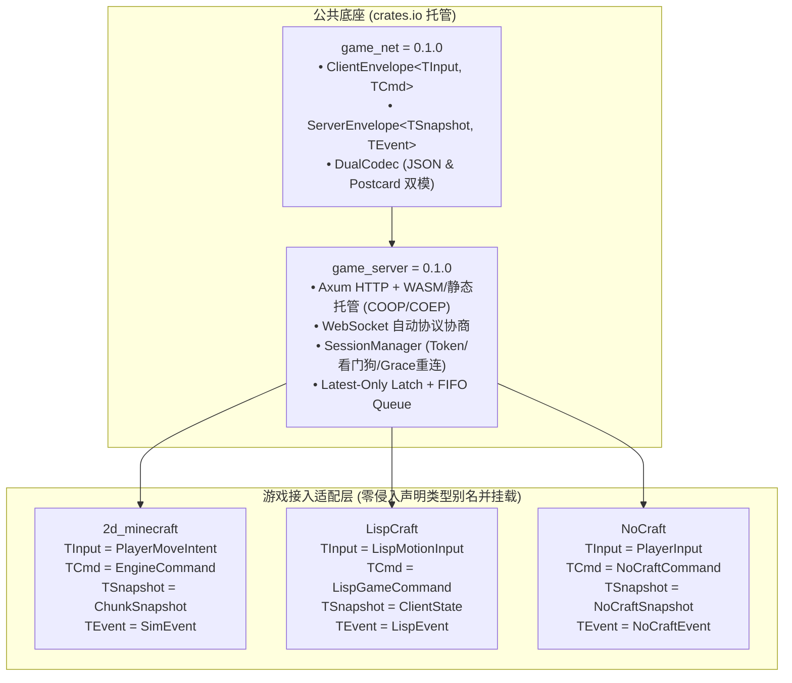

# 跨游戏通用网络底座与移植总览 (Cross-Game Networking Porting Portal)

本文档是跨三款游戏（`2d_minecraft`、`LispCraft`、`NoCraft`）的通用网络底座移植与复用总目录。

目前通用协议与会话网关底座已正式发布至官方 crates.io：
- **`game_net` (`v0.1.0`)**：[crates.io/crates/game_net](https://crates.io/crates/game_net)
- **`game_server` (`v0.1.0`)**：[crates.io/crates/game_server](https://crates.io/crates/game_server)

---

## 1. 针对各游戏专属 Agent 的移植文档

针对各个游戏的负责 Agent，已分别编写了定制化的移植指南：

1. **LispCraft Agent 指南**：👉 [`docs/PORTING_TO_LISPCRAFT.md`](file:///workspace/2d_minecraft/docs/PORTING_TO_LISPCRAFT.md)
   - 针对 `shared/src/lib.rs`（`ClientMsg::Move`, `Action`, `Command`, `ClientState`, `EntityDesc`）的 100% 映射指南。
   - Scheme 脚本执行与 `web/` WASM 浏览器客户端一体化托管部署说明。

2. **NoCraft Agent 指南**：👉 [`docs/PORTING_TO_NOCRAFT.md`](file:///workspace/2d_minecraft/docs/PORTING_TO_NOCRAFT.md)
   - 针对 `crates/engine-protocol`（`C2SMessage`, `S2CMessage`, `PlayerInput`, `ViewportSnapshot`）的 100% 映射指南。
   - `client-wasm` 浏览器直连与 `Grace Period` 掉线 60 秒无缝恢复配置说明。

---

## 2. 核心架构与零侵入复用模型

