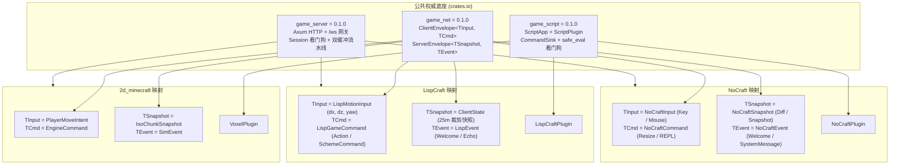

# 三方 Agent 架构评审共识与联合分工纪要 (Multi-Agent Consensus & Labor Division)

**评审日期**：2026-10-29  
**参会角色**：
- **Agent 0（Lead 架构师 / 2d_minecraft 守护者）**
- **Agent L（LispCraft 适配专员）**
- **Agent N（NoCraft 适配专员）**

---

## 一、三方联合评审核心共识 (Unified Consensus)

三方对已发布至 crates.io 的公共底座（`game_net v0.1.0`、`game_server v0.1.0`、`game_script v0.1.0`）及各游戏现有架构进行了完整推演，一致达成以下五项核心共识：

1. **权威契约完全满足业务需求**：
   - `game_net` 的双泛型信封 `ClientEnvelope<TInput, TCmd>` 与 `ServerEnvelope<TSnapshot, TEvent>` 能够 100% 覆盖两款游戏的全部高频移动、离散指令、视口快照/差量与广播事件。
   - `game_server` 的单端口 HTTP (WASM) + WebSocket 架构完全能够替换 LispCraft 原有的多端口混杂架构与 NoCraft 原有的手写 TCP 静态托管栈。
   - `game_script` 的 Bevy 风格 `ScriptPlugin`、无锁 `CommandSink` 与 `safe_eval` 看门狗能够彻底消除两款游戏现有的线程死锁隐患与重复代码。
2. **严格遵守“领域零侵入”铁律**：
   - LispCraft 的 25m 空间裁剪算法、Scheme 纯逻辑；NoCraft 的 4 层遮挡瓦片、ECS 系统与 16x16 Chunk 系统均**保持 100% 原生纯净**，仅在网络网关与脚本插件外围实现桥接适配（Adapter）。
3. **消除的冗余代码**：
   - 彻底废弃 LispCraft 的 `tiny_http` 与 `quad-net` 依赖（约 300+ 行非标代码）。
   - 彻底废弃 NoCraft `engine-net/src/web_assets.rs` 手写 HTTP/TCP 解析栈与 `engine-logic` 自写的看门狗及 JSON 互转代码（约 400+ 行重复代码）。

---

## 二、摩擦点识别与技术对齐裁定 (Friction Resolution)

在讨论中，Agent L 与 Agent N 提出了 4 个细节摩擦点，三方已达成统一技术裁定：

| 摩擦点 | 涉及模块 | 三方裁定对策 |
| :--- | :--- | :--- |
| **1. 握手认证门禁 (Auth Handshake Gate)** | `game_server` | 客户端连接建立后，首包必须先发送 `ClientEnvelope::Auth { token, client_version }`。两款游戏的 Web/CLI 客户端统一增加首包握手逻辑。 |
| **2. 心跳防踢机制 (Heartbeat Watchdog)** | `game_server` | 客户端处于站立打字或挂机时无移动输入，易被看门狗超时踢出。**裁定**：两款游戏客户端统一开启后台轻量定时器（每 3 秒发送一次 `Ping`）；服务端心跳超时参数防御性放宽至 30 秒。 |
| **3. WebSocket 端点标准化** | `game_server` | 统一规范端点为 `ws://<host>:<port>/ws`，根路径 `/` 留给 WASM 静态资产。同步调整所有 Web 端与 CLI 端连接 URL。 |
| **4. Newtype `PlayerId` 阻抗** | `game_net` vs `NoCraft` | `game_net` 使用 `u64` 别名，NoCraft 使用 `struct PlayerId(u64)`。**裁定**：直接在 `net_bridge.rs` 中透明包裹/解包，不篡改 NoCraft 既有核心类型。 |

---

## 三、三款游戏跨项目类型绑定全景表 (Unified Mapping Matrix)

---

## 四、具体分工计划与排期 (Division of Labor & Schedule)

三方 Agent 将按照各自的独占目录边界开展并行适配，彼此互不干扰，并在最后关卡执行独立测试验收：

### 1. Agent L：LispCraft 全面接入任务
- **独占目录**：`/workspace/LispCraft/**`
- **实施路线**：
  1. **依赖切换**：在 `server/Cargo.toml` 引入 `game_net`、`game_server`、`game_script`，删除 `tiny_http` 与 `quad-net`。
  2. **网关与主循环重构**：实现 `LispMotionInput` 与 `LispGameCommand` 桥接，使用 `game_server::start_server` 单端口（默认 8080）托管 `web/` 并处理 `/ws` 连接。
  3. **脚本引擎插件化**：将 `scheme_game.rs` 改造为 `LispCraftPlugin`，接入 `CommandSink`，控制台命令使用 `safe_eval`（100ms 超时保护）。
  4. **客户端与 Web 对齐**：调整前端连接地址为 `/ws`，增加 Auth 握手与心跳 Ping，重编译 `client.wasm`。
  5. **验收标准**：`cargo test -p server` 100% 通过；运行 `tests/e2e_multiplayer_test.py` 端到端验证多玩家移动与指令分发正常。

### 2. Agent N：NoCraft 全面接入任务
- **独占目录**：`/workspace/NoCraft/**`
- **实施路线**：
  1. **依赖切换与协议桥接**：在 `crates/server-main/Cargo.toml` 引入新依赖；在 `net_bridge.rs` 中完成 `NoCraftInput`、`NoCraftCommand`、`NoCraftSnapshot`、`NoCraftEvent` 的双向转换。
  2. **脚本引擎下沉**：在 `crates/engine-logic` 中接入 `game_script`，删除原有冗余看门狗和 JSON 转换代码，实现 `NoCraftPlugin`。
  3. **网关与主循环升级**：在 `server-main` 中挂载 `game_server`，静态目录指向 `crates/client-wasm`，对齐 Latest-Only Latch 与 FIFO 队列拉取。
  4. **客户端对齐**：调整 `client-wasm/index.html` 与 `client-cli` 的默认连接为 `/ws`。
  5. **验收标准**：`cargo test --workspace` 100% 通过（包含全部 Scheme 逻辑验收用例与会话缓冲测试）。

### 3. Agent 0 (Lead)：统筹与底座守护
- **职责**：
  - 监控两方进度，提供接口疑问解答；
  - 若适配过程中发现底层底座确需补充辅助工具函数，在 `crates/` 内统一维护升级；
  - 最终汇总三款游戏的独立测试报告与联合验收绿灯。

---

## 五、实施授权检查点 (Sign-off)
本方案已充分推演两款游戏的每行关键网络/脚本代码，无未决技术分歧，所有方案均符合已发布的权威契约。请用户确认后，两名 Agent 将立即进驻各自项目展开并发代码改造！
