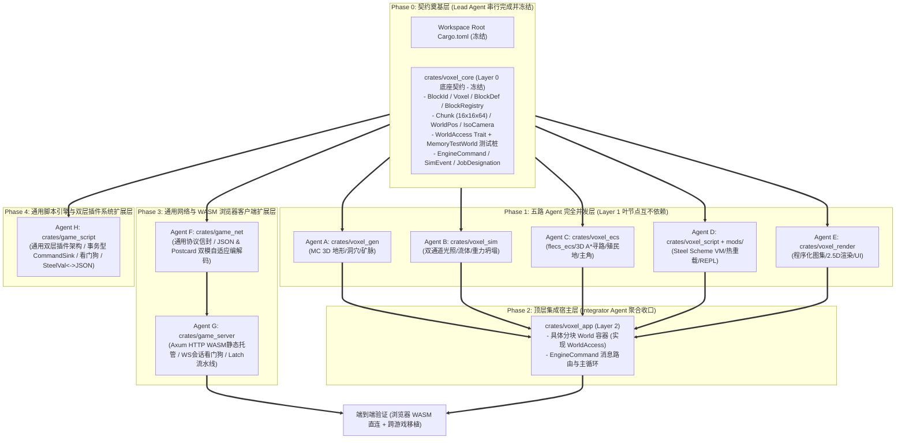

# 分阶段 AI Agent 协同并发工作手册 (Multi-Agent DAG Workflow)

本文档定义了 **2.5D 分层体素引擎** 在多 AI Agent 协同开发场景下的**单向树状无环 (DAG) 依赖拓扑、文件所有权隔离边界、分阶段同步屏障（Synchronization Barriers）以及各 Agent 的接口契约**，确保多个 Agent 并发写代码时**零文件冲突、零循环依赖、可独立编译与单元测试**。

---

## 1. 为什么 AI Agent 并行写代码会“打架”及根治方案

在传统单 Crate 项目中，多个 Agent 同时工作往往会在以下三个地方发生冲突：
1. **共同修改 `Cargo.toml` 或 `lib.rs / mod.rs`**：导致 Git/文件合并冲突或覆盖彼此的导出。
2. **平级模块互相引用（网状/环形依赖）**：例如 `ecs` 直接调用 `script`，`script` 又直接调用 `ecs` 和 `physics`，导致一个 Agent 还没写完或改了签名，另一个 Agent 就编译报错 (`cargo check` 失败)。
3. **缺少独立测试桩**：子模块必须等待整个 `World` 完成才能跑测试。

### 根治方案：三层单向星型树状 DAG (Strict 3-Tier Star-Tree DAG)

我们将 Workspace 严格拆分为 **3 个层级（7 个 Crate）**，其中承载 85% 代码量的 **Layer 1 包含 5 个完全正交、彼此零依赖的叶节点 Crate**：



> [!IMPORTANT]
> **核心铁律（DAG 依赖不变量）**：
> 1. `voxel_core`、`game_net` 与 `game_script` 属于 Layer 0 纯契约与抽象层，不依赖 Workspace 内的任何业务 Crate。
> 2. `voxel_gen`、`voxel_sim`、`voxel_ecs`、`voxel_render` 只依赖 `voxel_core`。
> 3. `voxel_script` 仅单向依赖 `voxel_core` 与 `game_script`，作为体素业务插件挂载。
> 4. `game_server` 仅单向依赖 `game_net` 与通用网络库，与具体游戏业务零耦合。
> 5. `voxel_app` 负责顶层组装，连接游戏仿真、网络网关与脚本引擎。

---

## 2. 文件读写所有权隔离矩阵 (File Ownership & Write-Scope Matrix)

每个 AI Agent 被严格限制在自己的独占目录内写入文件，跨界修改一律禁止：

| Agent 角色 | 所属阶段 | 允许写入路径 (Write Scope) | 只读参考路径 (Read-Only) | 禁止触碰路径 | 独立验证命令 |
| :--- | :--- | :--- | :--- | :--- | :--- |
| **Lead Agent** | Phase 0 & 3.0 & 4.0 | `/Cargo.toml`<br>`crates/voxel_core/**`<br>各 Crate 初始 `Cargo.toml` | 全局 | — | `cargo test -p voxel_core` |
| **Agent A**<br>(地形生成专家) | Phase 1 | `crates/voxel_gen/src/**` | `crates/voxel_core/src/**` | 根 `Cargo.toml` 及其他所有 Crate | `cargo test -p voxel_gen` |
| **Agent B**<br>(物理光照专家) | Phase 1 | `crates/voxel_sim/src/**` | `crates/voxel_core/src/**` | 根 `Cargo.toml` 及其他所有 Crate | `cargo test -p voxel_sim` |
| **Agent C**<br>(ECS与AI专家) | Phase 1 | `crates/voxel_ecs/src/**` | `crates/voxel_core/src/**` | 根 `Cargo.toml` 及其他所有 Crate | `cargo test -p voxel_ecs` |
| **Agent D**<br>(Scheme Mod专家) | Phase 1 | `crates/voxel_script/src/**`<br>`mods/**` | `crates/voxel_core/src/**` | 根 `Cargo.toml` 及其他所有 Crate | `cargo test -p voxel_script` |
| **Agent E**<br>(等距渲染与UI专家) | Phase 1 | `crates/voxel_render/src/**` | `crates/voxel_core/src/**` | 根 `Cargo.toml` 及其他所有 Crate | `cargo check -p voxel_render` |
| **Agent F**<br>(网络协议专家) | Phase 3 | `crates/game_net/src/**`<br>`crates/game_net/Cargo.toml` | 全局协议标准 | 业务游戏代码目录 | `cargo test -p game_net` |
| **Agent G**<br>(网关与服务端专家) | Phase 3 | `crates/game_server/src/**`<br>`crates/game_server/Cargo.toml`<br>`assets/web/**` | `crates/game_net/**` | 业务游戏代码目录 | `cargo test -p game_server` |
| **Agent H**<br>(通用脚本与插件专家) | Phase 4 | `crates/game_script/src/**`<br>`crates/game_script/Cargo.toml` | 全局架构与规范 | 业务游戏代码目录 | `cargo test -p game_script` |
| **Integrator Agent** | Phase 2 & 3.2 & 4.2 | `crates/voxel_app/src/**`<br>`docs/**` | 全部 `crates/**` 与 `mods/**` | 尽量不改动叶节点底层实现 | `cargo test --workspace` |

> [!TIP]
> **为什么连 `Cargo.toml` 都不会冲突？**
> 在 Phase 0 中，Lead Agent 会一次性在根目录 `Cargo.toml` 的 `[workspace.dependencies]` 中声明好 `macroquad`、`hecs`、`noise`、`rand`、`steel-core`，并预先写好全部 7 个子 Crate 的 `Cargo.toml`。因此 Phase 1 的 5 个 Agent **完全不需要运行 `cargo add` 或编辑任何 `Cargo.toml`**，只管写各自 `src/` 下的 Rust 代码。

---

## 3. 跨 Crate 解耦契约 (`crates/voxel_core` 冻结规范)

为了让 5 个 Layer 1 Crate 彼此不知道对方的存在却能无缝协作，`voxel_core` 在 Phase 0 提供三大解耦支柱：

### 3.1 世界访问抽象 (`WorldAccess` Trait + `MemoryWorld` 测试桩)
`voxel_sim`、`voxel_ecs`、`voxel_script`、`voxel_render` 都不直接依赖具体的 `World` 结构体，而是面向 `voxel_core::WorldAccess` 编程：

```rust
pub trait WorldAccess {
    fn get_voxel(&self, pos: WorldPos) -> Voxel;
    fn set_voxel(&mut self, pos: WorldPos, voxel: Voxel) -> bool;
    fn get_block_id(&self, pos: WorldPos) -> BlockId {
        self.get_voxel(pos).id
    }
    fn set_block(&mut self, pos: WorldPos, id: BlockId, meta: u8) -> bool;
    fn surface_z(&self, x: i32, y: i32) -> i32;
    fn in_bounds(&self, z: i32) -> bool {
        (0..CHUNK_HEIGHT as i32).contains(&z)
    }
}
```
同时，`voxel_core` 内置一个轻量级的 `MemoryWorld`（基于 `HashMap<ChunkPos, Chunk>` 实现 `WorldAccess`），使得 **Agent B / C / D 在 Phase 1 可以直接用 `MemoryWorld` 编写并运行完整的单元测试**，无需等待 Phase 2！

### 3.2 跨系统指令与事件总线 (`EngineCommand` & `SimEvent`)
当 `voxel_ecs`（玩家/矮人）或 `voxel_script`（Steel Scheme 脚本）想要改变世界、生成单位、下达殖民地任务或触发特效时，统一产出 `voxel_core::EngineCommand`；当世界方块发生变化时，产出 `voxel_core::SimEvent`：

```rust
#[derive(Clone, Debug, PartialEq)]
pub enum EngineCommand {
    SetBlock { pos: WorldPos, id: BlockId, meta: u8, by_player_or_colonist: bool },
    FillBox { min: WorldPos, max: WorldPos, id: BlockId, hollow: bool },
    SpawnFluid { pos: WorldPos, id: BlockId, level: u8 },
    SpawnColonist { pos: WorldPos, name: String },
    TeleportPlayer { pos: WorldPos },
    SetSliceZ { slice_z: i32 },
    DesignateBox { min: WorldPos, max: WorldPos, job_type: JobType, build_block: BlockId },
    InvokeModTool { tool_name: String, pos: WorldPos },
    LogMessage { text: String },
}

#[derive(Clone, Debug, PartialEq)]
pub enum SimEvent {
    BlockPlaced { pos: WorldPos, id: BlockId },
    BlockMined { pos: WorldPos, old_id: BlockId },
    BlockInteracted { pos: WorldPos, id: BlockId },
    AtlasRebuildNeeded,
}
```

### 3.3 渲染快照视图 (`RenderSnapshot` 数据传输对象)
为了让 `voxel_render` 不依赖 `voxel_ecs` 或 `voxel_script`，`voxel_core` 定义纯数据结构的视图 DTO：
- `ActorRenderView { id: u32, pos: WorldPos, kind: ActorKind, name: String, carrying: Option<BlockId>, busy_progress: f32 }`
- `JobRenderView { pos: WorldPos, job_type: JobType, build_block: BlockId }`
- `UiStateView`（包含当前模式 `GameMode`、`slice_z`、选中的方块/工具、Scheme 自定义工具列表、REPL 历史日志与输入框文本）

---

## 4. 三阶段执行流程与各 Agent 详细任务书

### Phase 0：契约冻结阶段 (Sequential Foundation)
- **执行者**：Lead Agent（单线程执行）
- **任务清单**：
  1. 配置根 `/workspace/2d_minecraft/Cargo.toml` 为 Workspace，固定全部依赖版本并生成 `Cargo.lock`。
  2. 创建 7 个子 Crate 目录及各自的 `Cargo.toml`。
  3. 完整实现 `crates/voxel_core`：
     - `block.rs`：`BlockId` (`0..=26` 内置常量 + `27..=254` 动态槽位)、`Voxel` (4 字节)、`BlockDef`（含三面 RGB、发光度、固/液/斜坡/楼梯/重力标记）、`BlockRegistry`。
     - `chunk.rs`：`Chunk` (`16×16×64`)、局部坐标索引、脏标记。
     - `coords.rs`：`WorldPos`、`ChunkPos`、`CardinalDir`、`IsoCamera`（4 方向 90° 旋转、屏幕与等距世界坐标正逆变换、射线拾取与锁定 Z 平面框选计算）。
     - `traits.rs`：`WorldAccess` Trait、`MemoryWorld` 实现、`EngineCommand`、`SimEvent`、`GameMode`、`JobType`、`ActorRenderView`、`UiStateView`。
- **Phase 0 准出屏障 (Gate 0)**：
  - `cargo check --workspace` 零错误通过。
  - `cargo test -p voxel_core` 单元测试全部通过。
  - **锁定声明**：从此时间点起，`Cargo.toml` 与 `crates/voxel_core` 进入只读冻结状态。

---

### Phase 1：五路 Agent 并发冲刺阶段 (5-Way Parallel Execution)

Gate 0 通过后，以下 5 个 Agent **同时启动、并行编码**：

#### 🛠️ Agent A：`crates/voxel_gen`（Minecraft 风格 3D 地形生成器）
- **独占路径**：`crates/voxel_gen/src/**`
- **依赖输入**：`voxel_core::{BlockRegistry, Chunk, ChunkPos, WorldPos, block::*, chunk::*}`
- **交付接口**：
  - `pub struct TerrainGenerator { seed: u32, ... }`
  - `impl TerrainGenerator { pub fn new(seed: u32) -> Self; pub fn generate_chunk(&self, chunk_pos: ChunkPos) -> Chunk; }`
- **功能要求**：
  - 使用 2D 多倍频 Simplex/Perlin 噪声生成大陆高度、温度与湿度，划分平原森林、沙漠、雪山、河湖生物群系。
  - 使用 3D 密度噪声 + 双通道绝对值交集（Spaghetti & Cheese Caves）雕刻地下洞穴网络，并在深层 (`z <= 8`) 填充静止岩浆湖 (`LAVA`)，海平面 (`z <= 22`) 填充水体 (`WATER`)。
  - 按深度生成煤矿、铁矿、金矿、钻石矿脉；在地表生成橡木树干+树叶，并在相邻高度差为 1 的自然山坡自动放置对应朝向的斜坡 (`RAMP`)。
- **独立验收**：编写单元测试验证相同种子生成的分块确定性、地表高度合法性、洞穴与矿脉存在性，运行 `cargo test -p voxel_gen`。

#### 🌊 Agent B：`crates/voxel_sim`（双通道光照、流体与重力坍塌模拟）
- **独占路径**：`crates/voxel_sim/src/**`
- **依赖输入**：`voxel_core::{WorldAccess, BlockRegistry, WorldPos, Voxel, block::*}`
- **交付接口**：
  - `pub struct SimulationEngine { ... }`
  - `pub fn recompute_lighting(world: &mut dyn WorldAccess, registry: &BlockRegistry, min: WorldPos, max: WorldPos)`
  - `pub fn step_physics(world: &mut dyn WorldAccess, registry: &BlockRegistry, active_center: WorldPos, radius: i32) -> usize`
  - `pub fn check_structural_collapse(world: &mut dyn WorldAccess, registry: &BlockRegistry, mined_pos: WorldPos) -> usize`
- **功能要求**：
  - **双通道 BFS 光照 (`lighting.rs`)**：垂直投射天空光 `SkyLight (0..15)`（遇树叶/水衰减），加上 `BlockLight (0..15)`（火把/萤石/岩浆及自定义发光 Mod 方块），6 邻域 BFS 传播。
  - **流体模拟 (`physics.rs`)**：支持 8 级水位 (`1..=7`)，优先向 `(x, y, z-1)` 下落，受阻则向四周低水位格扩散；水与岩浆相遇生成 `COBBLESTONE` 或 `OBSIDIAN`。
  - **重力与悬空坍塌 (`physics.rs`)**：具有 `gravity = true` 的方块（沙子、沙砾或自定义重力 Mod 方块）下方悬空时下坠或沿休止角斜向滑落；当方块被挖除时，在 `MAX_CANTILEVER = 5` 半径内执行连通域支撑 BFS，未连接到地面/山体边界的悬空簇自动断裂下坠。
- **独立验收**：使用 `voxel_core::MemoryWorld` 编写光照传播、水流扩散、水火反应生成黑曜石、悬臂梁挖断坍塌的单元测试，运行 `cargo test -p voxel_sim`。

#### 🧭 Agent C：`crates/voxel_ecs`（ECS 实体、3D 跨层 A* 寻路、殖民地与主角控制）
- **独占路径**：`crates/voxel_ecs/src/**`
- **依赖输入**：`voxel_core::{WorldAccess, BlockRegistry, WorldPos, CardinalDir, EngineCommand, JobType, ActorRenderView, JobRenderView}`
- **交付接口**：
  - `pub fn find_path_3d(world: &dyn WorldAccess, registry: &BlockRegistry, start: WorldPos, goal: WorldPos, max_nodes: usize) -> Option<Vec<WorldPos>>`
  - `pub struct EcsManager { ... }`（封装 `hecs::World`、玩家实体、矮人殖民者 AI 列表、殖民地任务队列 `JobManager`）
  - 提供玩家移动/爬坡/挖掘/放置方法、殖民地矩形框选任务注册与 AI Tick 调度（产出 `Vec<EngineCommand>`），以及导出 `Vec<ActorRenderView>` 与 `Vec<JobRenderView>` 供渲染器绘制。
- **功能要求**：
  - `1×1×1` 实体通行判定：站在 `z-1` 实心方块上，占据 `z` 层空间；3D A* 支持同层 8 向移动（防穿墙角）、通过 `RAMP` / `STAIR` / `LADDER` 升层 (`z -> z+1`)、通过斜坡/楼梯或安全跳落 1 格降层 (`z -> z-1`)。
  - 殖民地 AI 状态机：`Idle` -> 认领最近的可达 `JobDesignation` -> 沿 3D A* 路径移动至作业点邻格 -> 施工计时 -> 产出 `EngineCommand::SetBlock` 完成挖掘/建造。
- **独立验收**：使用 `MemoryWorld` 测试平地绕障、通过 `RAMP` 爬上 3 层高台、殖民者认领挖掘任务并完成的单元测试，运行 `cargo test -p voxel_ecs`。

#### 📜 Agent D：`crates/voxel_script` + `mods/`（Steel Scheme Mod 引擎与示例 Mod 包）
- **独占路径**：`crates/voxel_script/src/**` 与 `/workspace/2d_minecraft/mods/**`
- **依赖输入**：`voxel_core::{WorldAccess, BlockRegistry, BlockDef, WorldPos, EngineCommand, SimEvent, JobType}` + `steel-core`
- **交付接口**：
  - `pub struct ScriptEngine { ... }`
  - 支持加载/热重载 `mods/*.scm` (`reload_mods(&mut self, world: &mut dyn WorldAccess, registry: &mut BlockRegistry) -> Result<Vec<String>, String>`)
  - 支持 REPL 表达式求值 (`eval_repl(&mut self, expr: &str, world: &mut dyn WorldAccess, registry: &mut BlockRegistry) -> Result<String, String>`)
  - 支持触发钩子 (`on_init`, `on_tick`, `on_block_placed`, `on_block_mined`, `on_block_interact`, `on_custom_tool`) 并返回产出的 `Vec<EngineCommand>` 及是否需要重建图集。
- **功能要求**：
  - 向 Steel Scheme 注入完整的引擎原语：`register-block!`、`get-block`、`get-block-id`、`block-id`、`set-block!`、`fill-box!`、`hollow-box!`、`spawn-fluid!`、`get-surface-z`、`player-pos`、`teleport-player!`、`spawn-colonist!`、`designate-box!`、`register-hook!`、`register-tool!`、`mod-log`。
  - 编写 3 个高质量官方示例 `.scm` 脚本放入 `mods/`：
    1. `00_stdlib.scm`：常用几何建造宏（圆盘、球体、螺旋阶梯、地下房间生成辅助函数）。
    2. `01_magic_blocks.scm`：注册秘银矿 (`mythril_ore`)、发光水晶 (`aether_crystal`)、不稳定的流沙 (`quicksand`) 等自定义 Mod 方块，以及挖掘钻石/秘银时的奖励事件钩子。
    3. `02_structures_and_tools.scm`：注册自定义上帝笔刷工具（如 `"Build Watchtower"` 一键在点击处生成带螺旋楼梯与火把的多层瞭望塔、`"Meteor Strike"` 陨石坑加岩浆笔刷、`"Auto Mine Vein"` 殖民地自动框选矿脉工具）。
- **独立验收**：编写单元测试验证 Scheme 动态注册新方块到 `BlockRegistry`、执行 `fill-box!` 修改 `MemoryWorld`、触发钩子函数及 REPL 求值，运行 `cargo test -p voxel_script`。

#### 🎨 Agent E：`crates/voxel_render`（程序化像素图集、2.5D 等距切片渲染与 UI）
- **独占路径**：`crates/voxel_render/src/**`
- **依赖输入**：`voxel_core::{WorldAccess, BlockRegistry, IsoCamera, WorldPos, ActorRenderView, JobRenderView, UiStateView, ...}` + `macroquad`
- **交付接口**：
  - `pub struct IsoAtlas { ... }`（根据 `BlockRegistry` 动态合成所有内置与 Mod 方块的 2.5D 顶/左/右像素纹理、斜坡、楼梯与半透明流体贴图，支持 `rebuild(&mut self, registry: &BlockRegistry)`）
  - `pub struct WorldRenderer { ... }`（执行 Back-to-Front 画家算法渲染、3 邻面遮挡剔除、基于 `slice_z` 的多层深度雾化、双通道光照着色、角色头顶自动透视切割、选中方块高亮框、殖民地蓝图半透明预览与矮人/主角绘制）
  - `pub struct HudRenderer { ... }`（绘制顶部模式切换栏 `F1/F2/F3`、Z 切片高度计与旋转指示器、底部方块调色板——自动包含 Mod 新增方块、殖民地指令与 Mod 自定义工具栏、右侧快捷键帮助与按键可唤出的交互式 Steel Scheme REPL 终端面板）
- **独立验收**：运行 `cargo check -p voxel_render` 与图集像素缓冲区生成的纯 CPU 单元测试 `cargo test -p voxel_render`。

---

### Phase 2：顶层组装与联调阶段 (Integration & Verification)
- **执行者**：Integrator Agent（在 Gate 1 全部 5 个 Crate 通过测试后执行）
- **独占路径**：`crates/voxel_app/src/**`
- **任务清单**：
  1. 在 `crates/voxel_app/src/world.rs` 中实现 `World` 容器，聚合 `HashMap<ChunkPos, Chunk>` 与 `voxel_gen::TerrainGenerator`，实现 `voxel_core::WorldAccess` Trait，支持按玩家/摄像机视野动态生成分块。
  2. 在 `crates/voxel_app/src/app.rs` 中实现主状态机 `EngineApp`：
     - 处理键盘/鼠标输入（`WASD` 移动/平移、`Q/E` 或滚轮切 `slice_z`、`R` 90° 旋转视角、`F1/F2/F3` 切换主角/殖民地/上帝编辑模式、`F5` 热重载 Scheme Mod、`` ` `` 或 `F12` 开关 Scheme REPL 终端）。
     - 统一消费并执行来自 `voxel_ecs`、`voxel_script` 和 UI 的 `EngineCommand` 队列，触发 `voxel_sim` 的增量光照、流体与坍塌模拟，并在自定义方块更新时通知 `IsoAtlas::rebuild`。
  3. 执行全量验证：
     - `cargo test --workspace`（验证全部 7 个 Crate 的单元与集成测试）
     - `cargo build --workspace`（验证完整可执行程序构建通过）

---

### Phase 3：通用网络与 WebAssembly 浏览器客户端扩展 (Generic Network & WASM Browser)

当基础体素引擎在 Phase 2 完成验证后，启动 Phase 3 网络化演进，严格遵循双 Agent 隔离并发开发原则：

#### 🌐 Agent F：`crates/game_net`（跨游戏通用协议与双模编解码专家）
- **独占路径**：`crates/game_net/src/**` 与 `crates/game_net/Cargo.toml`
- **依赖输入**：`serde` + `serde_json` + `postcard`（绝对零业务依赖，跨三款游戏通用）
- **交付接口**：
  - `pub enum ClientEnvelope<TInput, TCmd> { Auth, Ping, Input(TInput), Command(TCmd) }`
  - `pub enum ServerEnvelope<TSnapshot, TEvent> { AuthSuccess, Pong, Snapshot(TSnapshot), Event(TEvent), Kick }`
  - `pub struct DualCodec`：提供 `encode_text` / `decode_text`（JSON 格式用于调试）与 `encode_binary` / `decode_binary`（Postcard 二进制用于生产），支持帧自适应解码。
- **独立验收**：编写单元测试验证 JSON 与二进制编解码一致性，运行 `cargo test -p game_net`。

#### 🚀 Agent G：`crates/game_server`（Axum HTTP WASM 托管与 WebSocket 会话网关专家）
- **独占路径**：`crates/game_server/src/**`、`crates/game_server/Cargo.toml` 与 `assets/web/**`
- **依赖输入**：`game_net` + `axum` + `tokio` + `tower-http` + `dashmap`
- **交付接口**：
  - `pub struct GenericGameServer<TInput, TCmd, TSnapshot, TEvent>`
  - `start_server(config: ServerConfig, static_dir: PathBuf) -> ServerHandle`：在指定端口同时绑定 HTTP 静态文件服务（自动提供 WASM 与 COOP/COEP 安全头）与 `/ws` WebSocket 路由。
  - `SessionManager`：管理 Token、心跳保活检测、Grace Period 重连。
  - 双通道输入摄取：`drain_inputs() -> Vec<(PlayerId, TInput)>` 与 `drain_commands() -> Vec<(PlayerId, Vec<TCmd>)>`。
- **独立验收**：启动模拟测试服务端，用虚拟客户端进行双向消息与心跳测试，运行 `cargo test -p game_server`。

#### 🎯 Integrator Agent：端到端验证与跨游戏移植交付
- 在 `voxel_core` 中对齐序列化，在 `voxel_app` 中挂载网络网关。
- 验证浏览器访问 `http://localhost:8080/` 加载静态资源并直连 WebSocket。
- 编写并在 `docs/CROSS_GAME_PORTING.md` 中产出《跨游戏网络模块移植指南》，移交 `LispCraft` 与 `NoCraft` 对应 Agent 自主对接。

---

### Phase 4：通用脚本引擎与双层插件系统扩展 (Generic Script Engine & Plugin System)

在通用网络底座完成后，启动 Phase 4 脚本抽象化演进，将三款游戏共同依赖的 Steel Scheme 虚拟机基础设施下沉为独立的通用层：

#### ⚙️ Agent H：`crates/game_script`（通用脚本与插件系统专家）
- **独占路径**：`crates/game_script/src/**` 与 `crates/game_script/Cargo.toml`
- **依赖输入**：`steel-core` (0.8.3) + `serde` + `serde_json`（零体素业务依赖，跨三款游戏通用）
- **交付接口**：
  - `pub trait ScriptPlugin`：定义 `name(&self) -> &'static str` 与 `build(&self, ctx: &mut PluginContext) -> Result<(), PluginError>`（Bevy 风格装配）。
  - `pub struct CommandSink`：无锁事务型指令总线，提供 `emit<C: AnyCommand>(&self, cmd: C)` 与 `drain(&self) -> Vec<Box<dyn AnyCommand>>`，彻底杜绝借用冲突。
  - `pub struct ScriptApp`：Builder 模式宿主，支持 `.add_plugin(plugin)`、`.run(script)`、`.eval_repl(expr)`、`.safe_eval(expr, timeout_ms)`（带 Watchdog 超时保护）。
  - `interop.rs`：`steel_val_to_json` 与 `json_to_steel_val`（Scheme 与 JSON 递归无损转换）。
  - `watcher.rs`：`ScriptWatcher`（扫描脚本目录 `mtime`，支持自动热重载检测）。
- **独立验收**：编写单元与集成测试（覆盖插件装配、指令发射、REPL 求值、Watchdog 超时截断与 JSON 互转），运行 `cargo test -p game_script`。

#### 🎯 Integrator Agent：跨游戏移植指南更新
- 在 `docs/CROSS_GAME_PORTING.md` 中增加《通用脚本引擎与插件体系接入指南》，给出 `2d_minecraft`、`LispCraft` 与 `NoCraft` 的适配代码范式。
