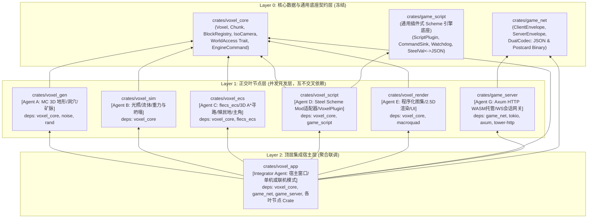

# 2.5D 分层体素引擎（Dwarf Fortress × Minecraft）架构设计蓝图

本方案汇总了前序沟通中已收敛的全部核心意图，定义了基于 **Rust + Macroquad + hecs** 的 2.5D 等距分层体素引擎的完整架构与分阶段交付计划。

---

## 1. 已收敛的核心设计决策汇总

| 维度 | 已选定方案 | 关键技术指标 |
| :--- | :--- | :--- |
| **技术栈与框架** | `Rust` + `Macroquad` + `flecs_ecs` + `noise` | 轻量级即时模式 2D/2.5D 渲染管线 + 官方工业级 Flecs ECS 实体关系系统 |
| **视觉与投影** | 2:1 经典 2D 等距瓦片 (Isometric) + 4 方向 90° 旋转 | 支持 `Z` 轴分层剖切 (`slice_z`)、下层深度雾化变暗、上层隐藏或半透明轮廓 |
| **体素数据模型** | 纯粹方块结构 (Minecraft 风格) | 每个 `(x, y, z)` 仅含单一 `BlockId` + 状态元数据，斜坡/楼梯/水均为特殊方块 |
| **世界规模** | 动态分块加载 (`Chunk` = `16 × 16 × 64`) | 水平方向按需生成与缓存 (`HashMap<(i32, i32), Chunk>`)，垂直 64 层 |
| **实体与通行** | 单格高实体 (`1 × 1 × 1`) | 站在 `z-1` 实心方块顶面、占据 `z` 层空间；通过斜坡(`Ramp`)/楼梯(`Stair`)跨 `Z` 层移动 |
| **交互与拾取** | 射线拾取 + 锁定 `Z` 层平面框选混合模式 | 支持点击可见方块表面，以及锁定当前 `slice_z` 矩形框选下达挖掘/建造指令 |
| **贴图资产** | 内置程序化像素风等距纹理图集 (Procedural Atlas) | 启动时自动合成带明暗三面、像素噪点、流体半透明与裂纹动画的瓦片图集 |
| **三大玩法模式** | 主角生存探索 + 殖民地 AI 调度 + 上帝世界编辑器 | 同一世界内一键无缝切换（附身控制主角 / 框选蓝图派发 AI 任务 / 自由笔刷改地形） |
| **Mod 脚本系统** | 通用 `game_script` + `steel-core 0.8.3` | 工业级双层插件架构 (`ScriptPlugin`)、无借用冲突的指令总线 (`CommandSink`)、看门狗超时中断 (`Watchdog`)、文件监听动态热重载与游戏内交互式 REPL 控制台 |
| **通用网络与网关** | `game_net` + `game_server` (`Axum` + `WebSocket`) | 内置 HTTP WASM 静态托管、原生 WebSocket 全双工、测试期 JSON / 正式期二进制双模自适应、Token 会话看门狗与高频移动锁存 |
| **跨端跨游戏复用** | WebAssembly 浏览器直连 + 3 游戏共享三大底座 | 浏览器开箱即玩；`game_net`、`game_server`、`game_script` 均支持向 `LispCraft` 与 `NoCraft` 零修改平移复用 |

---

## 2. 单向树状无环 (DAG) Cargo Workspace 架构

为了让多个 AI Agent 并行编写代码时**零文件冲突、零循环依赖、可独立编译测试**，整个工程采用 **三层严格单向无环树（Strict 3-Tier Acyclic Tree）** 的 Cargo Workspace 结构：

- **Layer 0（底座契约层 `voxel_core`）**：定义所有跨模块共享的纯数据结构、Trait 接口（如 `WorldAccess`）、坐标投影数学、动态方块注册表（`BlockRegistry`）以及跨模块指令/事件总线（`EngineCommand` / `SimEvent`）。不依赖任何渲染或脚本重库。
- **Layer 1（五大正交叶节点 Crate — 100% 并行开发层）**：`voxel_gen`、`voxel_sim`、`voxel_ecs`、`voxel_script`、`voxel_render` **彼此之间绝对零依赖**，全部仅单向依赖 `voxel_core`。5 个 AI Agent 可在同一时间分别在各自 Crate 目录内独立开发与运行 `cargo test -p <crate>`，彻底杜绝改同一文件或互相阻塞。
- **Layer 2（顶层聚合可执行层 `voxel_app`）**：唯一拥有全部叶节点依赖的顶层组装层，实现具体的 `World` 容器与主循环调度。



### Workspace 目录与文件所有权隔离规划

```text
/workspace/2d_minecraft/
├── Cargo.toml                       # Workspace 根配置与统一依赖版本 (workspace.dependencies)
├── mods/                            # 官方示例 Steel Scheme Mod 脚本库
│   ├── 00_stdlib.scm
│   ├── 01_magic_blocks.scm
│   └── 02_structures_and_tools.scm
├── assets/web/                      # WebAssembly 静态客户端资源 (HTML, WASM, JS, 贴图)
│   ├── index.html
│   └── pkg/
└── crates/
    ├── voxel_core/                  # [Layer 0 - 核心体素数据契约]
    ├── game_net/                    # [Layer 0 - 通用网络信封与双模序列化 (已发布 crates.io)]
    ├── game_server/                 # [Layer 1 - 通用 HTTP WASM 托管与 WebSocket 网关 (已发布 crates.io)]
    ├── game_script/                 # [Layer 0 - 通用双层插件式 Scheme 脚本引擎 (跨3个游戏复用)]
    │   ├── Cargo.toml
    │   └── src/
    │       ├── lib.rs               # 导出 ScriptApp, ScriptPlugin, CommandSink 等
    │       ├── plugin.rs            # ScriptPlugin Trait 与 PluginContext
    │       ├── command.rs           # 事务型指令总线 CommandSink 与 AnyCommand
    │       ├── app.rs               # ScriptApp (Builder 模式、安全求值、Watchdog)
    │       ├── interop.rs           # SteelVal <-> JSON 双向序列化网桥
    │       └── watcher.rs           # 脚本目录 mtime 自动热重载监听器
    ├── voxel_script/                # [Layer 1 - 2d_minecraft 体素世界 Scheme 插件适配层]
    ├── voxel_gen/                   # [Layer 1 - 地形/洞穴生成]
    ├── voxel_sim/                   # [Layer 1 - 光照/流体/重力坍塌]
    ├── voxel_ecs/                   # [Layer 1 - flecs_ecs / 3D A*寻路]
    ├── voxel_render/                # [Layer 1 - 2.5D 切片渲染 / UI]
    └── voxel_app/                   # [Layer 2 - 顶层集成入口]
```

---

## 3. 核心子系统详细设计

### 3.1 紧凑体素数据结构 (`world/block.rs`)
每个体素仅占 **4 字节 (32 bits)**，保证 `16 × 16 × 64 = 16,384` 个体素的分块仅占 `64 KB`，极度契合 CPU 缓存：
- **`id: BlockId` (`u8`)**：
  - 基础地形：`Air(0)`, `Grass(1)`, `Dirt(2)`, `Stone(3)`, `Sand(4)`, `Gravel(5)`, `Snow(6)`, `Clay(7)`, `Bedrock(8)`
  - 矿物与资源：`CoalOre(9)`, `IronOre(10)`, `GoldOre(11)`, `DiamondOre(12)`, `WoodLog(13)`, `Leaves(14)`
  - 建筑与跨层结构：`Planks(15)`, `Cobblestone(16)`, `Brick(17)`, `Glass(18)`, `Ramp(19)` (四向斜坡), `Stair(20)` (上下楼梯), `Ladder(21)`
  - 光源与流体：`Torch(22)`, `Glowstone(23)`, `Water(24)`, `Lava(25)`, `Obsidian(26)`
- **`meta: u8`**：
  - 对流体方块：低 3 位存储液面高度 `level (1..=7)`，第 4 位标记是否处于垂直下落态 (`falling`)。
  - 对斜坡 `Ramp` / 楼梯 `Stair`：低 2 位存储朝向 (`North/East/South/West`)。
  - 对实心方块：存储挖掘受损进度 `0..15`。
- **`light: u8`**：高 4 位为 `SkyLight (0..15)`，低 4 位为 `BlockLight (0..15)`。
- **`flags: u8`**：包含 `discovered` (战争迷雾已探索标记)、`designated` (被殖民地标记为待挖掘/作业)、`unstable` (待物理检查)。

---

### 3.2 2.5D 等距坐标变换、4 向旋转与混合拾取 (`camera.rs`)
1. **4 方向相机旋转 (`Rotation: 0 | 1 | 2 | 3`)**：
   给定世界坐标 `(wx, wy, wz)` 与相机中心 `(cx, cy, slice_z)`，先将相对水平坐标 `(dx, dy) = (wx - cx, wy - cy)` 按当前 90° 旋转角变换为视图网格坐标 `(rx, ry)`：
   - `0° (North)`: `(rx, ry) = (dx, dy)`
   - `90° (East)`: `(rx, ry) = (-dy, dx)`
   - `180° (South)`: `(rx, ry) = (-dx, -dy)`
   - `270° (West)`: `(rx, ry) = (dy, -dx)`
2. **2:1 等距投影公式**：
   设基础菱形瓦片宽高为 `W = 32px`, `H = 16px`，单层 `Z` 高度偏移为 `Z_STEP = 16px`：
   $$screen\_x = center\_x + (rx - ry) \times \frac{W}{2} \times zoom$$
   $$screen\_y = center\_y + (rx + ry) \times \frac{H}{2} \times zoom - (wz - slice\_z) \times Z\_STEP \times zoom$$
3. **混合鼠标拾取机制**：
   - **平面锁定模式 (Plane Lock / 框选拖拽)**：将屏幕鼠标坐标直接反解到 `wz = slice_z` 的等距平面，得到精确的 `(wx, wy, slice_z)`，用于矩形框选挖掘、铺地板、划定殖民地作业区。
   - **3D 射线拾取模式 (Raycast)**：从顶层可见切片 `z = slice_z` 向下遍历至 `z = slice_z - max_visible_depth`，反算鼠标在该 `z` 层对应的体素 `(wx, wy, z)` 并精确检测鼠标像素落在菱形顶面、左前侧面还是右前侧面，返回 `(HitBlockPos, AdjacentPlacePos, HitFace)`。

---

### 3.3 画家算法遮挡剔除与分层切片渲染 (`render/iso_renderer.rs`)
- **渲染顺序 (Back-to-Front)**：
  在旋转后的视图坐标系 `(rx, ry, wz)` 下，按照深度键值 `depth_key = rx + ry` 从小到大（从后往前）、`wz` 从底层 `max(0, slice_z - VISIBLE_DEPTH)` 到 `slice_z` 依次绘制。
- **隐藏面与完全遮挡剔除 (Occlusion Culling)**：
  如果一个体素的**正上方 `(wx, wy, wz+1)`**、**视图左前方**、**视图右前方**全是不透明实心体素（且 `wz + 1 <= slice_z`），则该体素完全不可见，直接跳过绘制（可剔除 80%+ 的地下内部体素）。
- **深度雾化与光照合成**：
  - 距离当前切片层越深 (`delta_z = slice_z - wz > 0`)，叠加蓝紫色深度雾化衰减因子，既能看清深渊/峡谷的立体层次，又能一眼区分哪些方块位于当前操作层 `slice_z`。
  - 当玩家角色位于室内或地道（头顶 `wz > slice_z` 或被岩石遮挡）时，自动对角色上方遮挡物启用局部切割/半透明轮廓显示。

---

### 3.4 Minecraft 风格 3D 地形生成 (`world/gen.rs`)
采用确定性种子 (`Seed`) 的多层噪声管线：
1. **生物群系与宏观地貌**：使用 2D 分形 Simplex 噪声计算温度 (`Temperature`)、湿度 (`Humidity`) 与大陆度 (`Continentalness`)，划分：**温带平原/森林**、**荒漠沙丘**、**雪山高原**、**河谷湖泊**。
2. **3D 密度场与洞穴系统**：
   - 结合 2D 基准高度与 3D 体积噪声生成陡峭悬崖与浮空拱门。
   - **3D 洞穴雕刻 (Cheese & Spaghetti Caves)**：利用双通道 3D 噪声绝对值交集 (`|n1| < threshold && |n2| < threshold`) 生成蜿蜒贯通的地下洞穴网络与地下熔岩湖 (`z < 10`)。
3. **矿脉与地表生态**：
   - 按 `Z` 轴深度分布生成煤矿、铁矿、金矿、钻石矿簇。
   - 地表自动生成树木 (`WoodLog` + `Leaves`)，并在自然高度差为 1 的坡道边缘自动生成自然斜坡 (`Ramp`)，使角色与矮人无需挖掘即可在自然山坡上跨层行走。

---

### 3.5 核心物理与环境模拟 (`world/physics.rs` & `lighting.rs`)
1. **双通道增量光照 (`lighting.rs`)**：
   - **天空光 (`SkyLight`)**：从 `z = 63` 垂直向下直射为 `15`（遇水/树叶每层衰减 `2`，遇实心方块归 `0`），再通过 6 邻域 BFS 向洞穴口内侧漫射。
   - **方块光 (`BlockLight`)**：火把 (`14`)、萤石 (`15`)、岩浆 (`15`) 作为光源种子，通过 BFS 每次衰减 `1` 向三维空间扩散。
2. **流体元胞自动机 (`Water` & `Lava`)**：
   - 优先向下流动：若下方 `(x, y, z-1)` 为空气，则生成满格下落水流 (`level = 7, falling = true`)。
   - 水平扩散：若下方为实心或已满流体，向四周 `level` 更低的空气/同种流体格平铺扩散（水每格衰减 1，岩浆每格衰减 2 且流速更慢）。
   - 水与岩浆接触反应：流动水遇岩浆生成圆石 (`Cobblestone`)，静止岩浆源遇水生成黑曜石 (`Obsidian`)。
3. **重力与悬空坍塌物理 (`physics.rs`)**：
   - **松散方块重力 (`Sand`, `Gravel`)**：下方为空或流体时直接下坠；若下方有支撑但四周斜下方 `(nx, ny, z-1)` 全空，则产生自然休止角滑坡。
   - **结构支撑与悬空坍塌**：当玩家或矮人挖掉方块时，对周围邻格启动局部连通域支撑搜索（限定最大搜索步数/悬挑半径 `MAX_CANTILEVER = 5`）。若某一局部方块簇在有效支撑半径内未连接到地面基岩或主山体，则整块悬空结构触发坍塌，逐层下坠并在落地时产生冲击。

---

### 3.6 3D 跨层寻路与三合一交互模式 (`ecs/`)
1. **3D A* 跨层寻路 (`pathfinding.rs`)**：
   - 节点状态 `(x, y, z)` 合法条件：`block(x,y,z)` 可通行（空气、斜坡、楼梯、火把、浅水）且 `block(x,y,z-1)` 可站立（实心方块或楼梯顶）。
   - 邻居扩展支持：
     - **同层 8 方向移动**（对角线移动要求两侧正交格均不阻挡）。
     - **上层攀爬 (`z -> z+1`)**：当前格为 `Stair/Ladder` 且 `(x, y, z+1)` 可通行；或目标相邻格为 `Ramp` 且其上方 `(nx, ny, z+1)` 可通行。
     - **下层移动 (`z -> z-1`)**：通过 `Ramp/Stair` 走下，或从高度差为 1 的边缘安全跳下 (`Drop 1`)。
2. **三大玩法模式无缝切换**：
   - **模式一：主角生存探索 (`F1` / UI 按钮)**：摄像机跟随主角（自动切到主角所在 `Z` 层），`WASD` 沿当前视角方向移动（遇 `Ramp` 自动升层，按 `Space/E` 上下楼梯），鼠标左键挖掘视线内方块、右键放置快捷栏方块。
   - **模式二：殖民地 AI 调度 (`F2` / UI 按钮)**：自由平移/升降 `slice_z` 切片（滚轮或 `Q/E` 切层，`R` 旋转视角），鼠标左键拖拽矩形框选区域，下达【挖掘 Mine】【挖下坡道 Channel】【建造墙体/斜坡/楼梯/火把】指令；场景中的多名矮人殖民者通过任务分配器自动认领最近任务、3D 寻路前往并执行施工。
   - **模式三：上帝世界编辑器 (`F3` / UI 按钮)**：支持可调半径笔刷（球形/方形/单层平面）、一键倾倒水/岩浆测试流体、刷出新的矮人/沙砾测试坍塌、调整昼夜时间与光照预览。

---

### 3.7 Steel (Scheme) Mod 脚本系统 (`scripting/` & `mods/*.scm`)
1. **动态方块注册表 (`BlockRegistry`)**：
   - `BlockId` 采用 `u8 (0..=255)`，内置方块占用 `0..=26`，`27..=254` 开放给 Scheme 脚本动态注册。
   - Scheme 调用 `(register-block! "mythril_ore" #x66ddff #x44aacc #x3388aa 8 #t #f)` 即可注册发光秘银矿，引擎自动为其合成 2.5D 等距像素瓦片并加入 UI 方块调色板。
2. **完整的内置 Scheme 原语 API**：
   - **世界读写**：`(get-block x y z)`, `(get-block-id x y z)`, `(set-block! x y z block)`, `(fill-box! x1 y1 z1 x2 y2 z2 block)`, `(hollow-box! x1 y1 z1 x2 y2 z2 block)`, `(spawn-fluid! x y z fluid level)`, `(get-surface-z x y)`
   - **实体与殖民地调度**：`(player-pos)`, `(teleport-player! x y z)`, `(spawn-colonist! x y z name)`, `(designate-box! x1 y1 z1 x2 y2 z2 job-type block)`
   - **事件钩子与自定义笔刷**：`(register-hook! event-name fn-name)`（支持 `"on-init"`, `"on-tick"`, `"on-block-placed"`, `"on-block-mined"`, `"on-block-interact"`），以及 `(register-tool! tool-name fn-name)`（在 UI 栏生成自定义 Mod 笔刷按钮，点击世界方块时触发对应 Scheme 函数）。
3. **开发工作流**：
   - **一键热重载 (`F5`)**：重新扫描加载 `mods/*.scm`，即时更新自定义方块、钩子与工具并重建纹理图集。
   - **游戏内交互式 REPL (`~` / `F12`)**：支持在画面内直接输入 Scheme 表达式求值并查看输出日志。
   - **官方示例 Mod 包 (`mods/`)**：内置标准辅助库 `00_stdlib.scm`、奇幻矿石与生态扩展 `01_magic_blocks.scm`、程序化建筑与魔法笔刷工具 `02_structures_and_tools.scm`。

---

### 3.8 通用网络底座、WASM 客户端与会话网关 (`game_net` & `game_server`)
1. **协议信封与双模自适应序列化 (`game_net`)**：
   - 通用客户端信封 `ClientEnvelope<TInput, TCmd>`（包含 `Auth`, `Ping`, `Input(TInput)`, `Command(TCmd)`）。
   - 通用服务端信封 `ServerEnvelope<TSnapshot, TEvent>`（包含 `AuthSuccess`, `Pong`, `Snapshot(TSnapshot)`, `Event(TEvent)`, `Kick`）。
   - **双模编解码 (`DualCodec`)**：
     - 测试/开发环境：使用 `serde_json` 文本帧，浏览器 DevTools 抓包一览无余。
     - 生产发布环境：使用 `postcard` 高效变长压缩二进制帧，体积小 80%+，CPU 零冗余负担。
2. **一体化 HTTP + WebSocket 网关 (`game_server/gateway.rs`)**：
   - 基于 `axum` + `tower-http` 在单端口同时提供静态资源托管与 WebSocket 服务。
   - 自动托管 `assets/web/` 下的 HTML、WASM、JS 与纹理资产，并注入 `Cross-Origin-Opener-Policy: same-origin` 与 `Cross-Origin-Embedder-Policy: require-corp` 安全头。
   - `/ws` 端点处理 WebSocket 连接升级，自动根据握手参数或首包识别 JSON / Binary 模式。
3. **会话状态机与心跳看门狗 (`game_server/session.rs`)**：
   - 管理 `Token -> SessionId -> PlayerId` 映射。
   - 状态流转：`Connecting -> Authenticated -> InGame -> Disconnected (Grace Period 60s) -> Terminated`。
   - 自动 Heartbeat 看门狗：10 秒无心跳自动标记掉线，Grace 保护期内重连无缝恢复实体与状态。
4. **并发双通道摄取流水线 (`game_server/pipeline.rs`)**：
   - **高频移动锁存 (`Latest-Only Latch`)**：针对玩家移动/朝向输入，每个玩家只暂存最新一帧，彻底杜绝网络卡顿时移动指令堆积滞后。
   - **离散交互队列 (`FIFO Command Queue`)**：挖掘、放置、技能、聊天、Scheme 脚本调用严格保持 FIFO 顺序。
   - 游戏循环每 Tick 仅需通过 `drain_inputs()` 和 `drain_commands()` 批量消费。

---

### 3.9 通用脚本引擎与双层插件系统 (`game_script`)
1. **工业级双层插件架构 (Two-Tier Plugin Architecture)**：
   - **Layer 1: 宿主 Rust 原生插件 (`ScriptPlugin` Trait)**：采用 Bevy 风格插件模式，各系统实现 `build(&self, ctx: &mut PluginContext)`，向 VM 注册原生函数。
   - **Layer 2: Scheme 脚本层 Mod**：由用户、策划或 Mod 开发者通过 `.scm` 脚本调用已注册原语，实现动态物品注册、逻辑计算与热重载。
2. **事务型指令总线 (`CommandSink`)**：
   - 彻底解决脚本调用 Rust 时的借用重入与死锁问题。
   - 脚本不直接强行修改游戏实体或世界内存，而是向 `CommandSink` 发射类型化指令，在游戏 Tick 的安全同步屏障处集中原子结算。
3. **安全沙箱与看门狗超时中断 (`Watchdog`)**：
   - 基于 `steel::ThreadStateController` 实现执行预算与超时看门狗保护。
   - 玩家或开发者在 REPL 中执行死循环或慢查询时自动中断并抛出异常，游戏进程保持 100% 稳定运行。
4. **跨语言通用数据网桥 (`SteelVal <-> JSON`)**：
   - 内置无损递归转换，支持 Rust `serde_json::Value` 与 Scheme `SteelVal` 自由互转。
5. **动态热重载监听器 (`Watcher`)**：
   - 自动扫描脚本目录的 `mtime`，变更时自动重新求值、刷新事件钩子与配方。

---

### 3.10 3D 体素 WebGL 渲染管线与双视角客户端 (`voxel_web`)
1. **原汁原味 Minecraft 3D 网格化 (Voxel 3D Meshing)**：
   - **面剔除 (Face Culling)**：仅在相邻方块为空气或透明时发射 Quad 顶点，剔除地下 90%+ 的内部不可见多边形。
   - **经典四角环境遮蔽 (AO Shading)**：依据方块四角邻接遮挡计算 4 级环境遮蔽渐变因子，赋予方块鲜明立体感。
   - **双通道 3D 光照着色**：将 `SkyLight (0..15)` 与 `BlockLight (0..15)` 映射至顶点属性，实现真实火把暖光与日光衰减。
2. **第一人称透视相机与操作映射**：
   - 鼠标视线锁定（Pointer Lock API）与自由视线旋转 (Pitch/Yaw)。
   - `WASD` 3D 地面行走与惯性移动，`Space` 跳跃，`Shift` 潜行。
3. **杀手级特性：一键双视角自由切换 (`V` 键)**：
   - **视角 A：2.5D 等距切片视角 (Isometric / Dwarf Fortress 模式)**：上帝俯视、框选蓝图、调度矮人。
   - **视角 B：第一人称真 3D 视角 (True 3D / Minecraft 模式)**：附身角色双眼，身临其境探险洞穴。
4. **轻量纯 WebAssembly 架构**：
   - 纯 Rust + Macroquad 3D，彻底剥离服务端 C 依赖（如 `flecs_ecs`），产物体积仅 1~2 MB，浏览器秒开 60~120 FPS。

---

## 4. 分阶段实施路线图 (DAG 并发演进模型)

配套的 AI Agent 协同并发执行细则详见《分阶段 AI Agent 协同并发工作手册》(`agent_concurrency_workflow.md`)：

1. **Phase 0：底座契约冻结 (Contract Freeze — Lead Agent 串行奠基)**
   - 建立根 Workspace `Cargo.toml` 及全部子 Crate 的空壳骨架。
   - 完整实现并冻结 `crates/voxel_core`，确保 `cargo test -p voxel_core` 100% 通过。
2. **Phase 1：五大正交叶节点 Crate 完全并行开发 (5 Agents Concurrency — 零文件冲突)**
   - **Agent A (`crates/voxel_gen`)**：实现 Minecraft 风格 3D 密度噪声地形、洞穴、生物群系、矿脉、树木与自然斜坡生成。
   - **Agent B (`crates/voxel_sim`)**：基于 `WorldAccess` Trait 实现双通道 BFS 光照、水/岩浆 8 级流体模拟、沙砾重力休止角滑落与 `MAX_CANTILEVER` 悬空坍塌。
   - **Agent C (`crates/voxel_ecs`)**：基于官方 `flecs_ecs` 实现预制体与组件系统、3D A* 跨层寻路、殖民地框选任务分配与主角移动/挖掘控制。
   - **Agent D (`crates/voxel_script` + `mods/`)**：实现 Steel Scheme VM 绑定、动态方块/工具/钩子 API、`F5` 热重载、REPL 求值器与 3 个官方示例 Mod 脚本。
   - **Agent E (`crates/voxel_render`)**：实现基于 `BlockRegistry` 的程序化像素等距图集、2.5D 画家算法切片渲染器、多模式 HUD 与交互式 REPL 终端界面。
3. **Phase 2：顶层宿主集成与端到端联调 (`crates/voxel_app` — Integrator Agent 聚合收口)**
   - 实现 `World` 容器（对接 `WorldAccess` Trait 与 `voxel_gen`），在 `app.rs` 中串联输入、渲染、`EngineCommand` 总线、模拟步进与 Scheme 钩子回调。
   - 执行全量 `cargo test --workspace` 与 `cargo check --workspace` 验证。
4. **Phase 3：通用网络与 WebAssembly 浏览器客户端扩展 (Generic Network & WASM Browser)**
   - **Phase 3.0：网络协议契约奠基 (`crates/game_net` — Agent F)**：实现泛型客户端/服务端信封与 `DualCodec`（JSON + Postcard 二进制双模），编写独立编解码单元测试。
   - **Phase 3.1：网关与会话引擎开发 (`crates/game_server` — Agent G)**：基于 `axum` + `tower-http` 实现 HTTP 静态托管 (WASM/HTML/Assets) + `/ws` WebSocket 路由，构建 `SessionManager` 看门狗与 Latch/FIFO 并发摄取流水线。
   - **Phase 3.2：2d_minecraft 集成与浏览器直连验证 (Integrator Agent)**：
     - 在 `voxel_core` 中对齐网络序列化字段，`voxel_app` 挂载网关。
     - 验证浏览器访问 `http://localhost:8080/` 加载静态资源并建立 WebSocket 联机。
   - **Phase 3.3：跨游戏移植指南交付**：产出 `docs/CROSS_GAME_PORTING.md`，赋能 `LispCraft` 与 `NoCraft` 负责 Agent 自主接入。
5. **Phase 4：通用脚本引擎与双层插件系统扩展 (Generic Script Engine & Plugin System)**
   - **Phase 4.0：模块骨架与契约配置 (Lead Agent)**：在 Workspace 引入 `crates/game_script` 依赖。
   - **Phase 4.1：通用插件引擎开发 (`crates/game_script` — Agent H)**：实现 `ScriptPlugin` Trait、`CommandSink`、`ScriptApp` Builder、看门狗中断保护、`SteelVal <-> JSON` 互转与文件监听器。
   - **Phase 4.2：跨游戏集成与移植规范输出 (Integrator Agent)**：更新 `docs/CROSS_GAME_PORTING.md`，指导 `LispCraft` 与 `NoCraft` 接入通用脚本底座。
6. **Phase 5：Web 浏览器 3D 体素客户端开发 (`crates/voxel_web` — Agent W)**
   - **Phase 5.0：骨架与 WebAssembly 配置 (Lead Agent)**：配置 `crates/voxel_web` 依赖与 Workspace。
   - **Phase 5.1：3D 网格化与 WebGL 渲染管线 (Agent W)**：实现 Face Culling、AO 4级阴影着色、第一人称透视相机、`V` 键双视角切换与 WebSocket 联机通信。
   - **Phase 5.2：端到端浏览器畅玩联调**：编译 WASM 产物至 `assets/web/`，验证在浏览器中流畅运行 3D Minecraft 视界！
